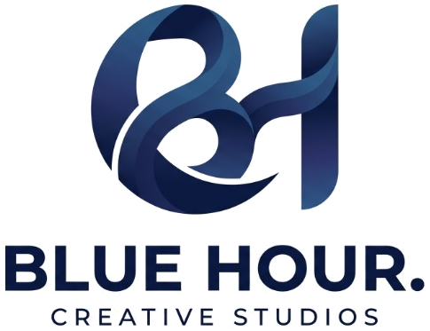

<div align="center">

  

  # Blue Hour Creative Studios
  ### Engineering Excellence. Creative Dominance.

  <p align="center">
    A hybrid creative technology and software powerhouse bridging bespoke enterprise engineering with viral social distribution to build the next generation of market-leading digital brands.
  </p>

  <p align="center">
    <a href="https://github.com/HimonBhuyan/Blue-Hour-Studios/stargazers"></a>
    <a href="https://github.com/HimonBhuyan/Blue-Hour-Studios/network/members"></a>
    
    
    
  </p>

  <p align="center">
    <a href="#-architectural-overview">Overview</a> •
    <a href="#-flagship-capabilities">Capabilities</a> •
    <a href="#-interactive-client-experience">Interactive Engine</a> •
    <a href="#-project-structure">Project Structure</a> •
    <a href="#-local-development">Local Setup</a> •
    <a href="#%EF%B8%8F-vercel-deployment">Vercel Deployment</a> •
    <a href="#-leadership--contact">Contact</a>
  </p>
</div>

---

## 🏛️ Architectural Overview

**Blue Hour Creative Studios** is architected to eliminate the traditional divide between deep software engineering and viral brand marketing. Designed from first principles with editorial typography, modular PHP layout encapsulation, and a zero-dependency Vanilla JavaScript client engine, the platform delivers sub-second load times and fluid 60-120 FPS micro-interactions.

### Key Highlights
- **Tri-Atmosphere Design System**: Seamless switching between **Porcelain Light** *(Default white mode for first-time visitors)*, **Dark Obsidian**, and **Blue Hour Twilight**.
- **Live Interactive Background Engine**: GPU-accelerated HTML5 canvas featuring a dynamic constellation mesh, mouse-repulsion physics, click shockwaves, and parallax aurora orbs.
- **Dual-Mode Deployment Architecture**: Runs natively on traditional Apache/XAMPP environments and seamlessly deploys as serverless micro-lambdas on **Vercel** (`vercel-php@0.9.0`).
- **Tactile Acoustic Sound Synthesis**: Synthesizes real-time micro-clicks and navigation audio using the browser's native Web Audio API (zero audio file downloads).
- **Dynamic Pricing & WhatsApp Routing**: Generates customized, encoded WhatsApp briefs with scope line-items for instant client onboarding.
- **Zero Heavy Framework Dependencies**: Pure Vanilla CSS and modern ES6 JavaScript for maximum speed, security, and low latency.

---

## ⚡ Flagship Capabilities

```
┌──────────────────────────────────────┐  ┌──────────────────────────────────────┐
│       01 // SOFTWARE & SAAS          │  │       02 // ENTERPRISE ERP & CRM     │
├──────────────────────────────────────┤  ├──────────────────────────────────────┤
│ • Full-stack web application portals │  │ • Fleet logistics & consignment hubs │
│ • High-conversion e-commerce engines │  │ • University campus management ERPs  │
│ • Custom microservices & REST APIs   │  │ • Granular RBAC & financial auditing │
│ • Sub-second edge infrastructure     │  │ • Real-time telemetry & GPS tracking │
└──────────────────────────────────────┘  └──────────────────────────────────────┘
┌──────────────────────────────────────┐  ┌──────────────────────────────────────┐
│       03 // MOBILE APPS & EDGE AI    │  │       04 // VIRAL BRAND & ADS        │
├──────────────────────────────────────┤  ├──────────────────────────────────────┤
│ • Cross-platform iOS & Android apps  │  │ • High-converting Meta & Google ads  │
│ • On-device intelligent algorithms   │  │ • Cinematic reels & scroll-stopping  │
│ • Real-time sync & offline caching   │  │ • High-ROAS multi-stage acquisition  │
│ • Native camera & hardware pipelines │  │ • Comprehensive brand identity kits  │
└──────────────────────────────────────┘  └──────────────────────────────────────┘
```

---

## 🎨 Interactive Client Experience

| Feature | Description | Implementation |
| :--- | :--- | :--- |
| **Porcelain Light Mode** | Clean, high-fashion editorial white design loaded by default for first-time visitors with zero flash of dark mode (FOUT-free). | Inline `<head>` DOM theme resolver + CSS tokens |
| **Live Dynamic Mesh** | Interactive particle constellation with magnetic mouse attraction, fluid repulsion, and expanding click shockwaves. | High-DPI HTML5 Canvas + Physics loop |
| **Parallax Aurora Orbs** | Ambient gradient illumination orbs that softly trail cursor motion with damped linear interpolation (`lerp`). | GPU-accelerated 3D CSS transforms |
| **Tactile Acoustic Sound** | Audiophile UI micro-feedback synthesized in-memory via oscillators and gain envelopes. | HTML5 Web Audio API |
| **Interactive Terminal** | Real-time simulated developer terminal showcasing stack initialization, build outputs, and deployment status. | Asynchronous typewriter queue |
| **Luxury Case Study Lightbox** | Deep-dive modal lightboxes rendering architecture blueprints, deliverables, tech stacks, and live links. | Client-side reactive modal state |

---

## 📂 Project Structure

```bash
Blue-Hour-Studios/
├── api/
│   ├── index.php             # Vercel serverless front-controller entry point
│   └── contact.php           # Strategic inquiry handler (JSON/form-encoded)
├── assets/
│   ├── css/
│   │   └── style.css         # Master architectural stylesheet (3-atmosphere tokens)
│   ├── js/
│   │   └── main.js           # Client engine (Audio, Canvas, Modals, Sliders)
│   └── images/               # Optimized logos, symbols, favicons, project media
├── data/
│   └── agency.json           # Centralized configuration (Team, Projects, Pricing)
├── includes/
│   ├── init.php              # Global environment bootstrap & helper routines
│   ├── header.php            # Modular navigation capsule & ambient canvas
│   └── footer.php            # Studio footprint, lightbox modal & global scripts
├── storage/
│   └── messages/             # Local inquiry storage (falls back to /tmp on serverless)
├── index.php                 # Overview (Hero, Metrics, Featured Works, Launchpad)
├── services.php              # Capabilities & Engineering disciplines
├── works.php                 # Selected case studies with tag-based filtering
├── pricing.php               # Transparent packages & interactive scope estimator
├── team.php                  # Leadership, engineering & creative team directory
├── contact.php               # Strategic desk & interactive brief submission
├── vercel.json               # Vercel serverless runtime & routing configuration
├── .vercelignore             # Exclusion rules for production serverless builds
└── .htaccess                 # Apache performance, compression & security directives
```

---

## 💻 Local Development

### Prerequisites
- **PHP 8.2+** (tested and optimized for PHP 8.3 / 8.4)
- **Apache** (via XAMPP / WampServer / LAMP) or PHP's built-in CLI server

### Option 1: Running with PHP CLI (Quickest)
Clone the repository and launch the built-in server from the root directory:

```bash
git clone https://github.com/HimonBhuyan/Blue-Hour-Studios.git
cd Blue-Hour-Studios
php -S 127.0.0.1:8000
```
Open [http://127.0.0.1:8000](http://127.0.0.1:8000) in your browser.

### Option 2: Running with XAMPP / Apache
1. Move or clone the directory into your Apache document root:
   ```bash
   # Windows XAMPP example
   c:\xampp\htdocs\Blue-Hour-Studios
   ```
2. Start the **Apache** service in the XAMPP Control Panel.
3. Access the application at:
   ```
   http://localhost/Blue-Hour-Studios/
   ```

---

## ☁️ Vercel Deployment

This project is pre-configured for **one-click deployment** to [Vercel](https://vercel.com/) via the community runtime `vercel-php@0.9.0`.

### Deploying via Vercel Dashboard
1. Fork or push this repository to your GitHub account.
2. Log in to [Vercel Dashboard](https://vercel.com/new).
3. Click **Add New... ➔ Project** and import **`HimonBhuyan/Blue-Hour-Studios`**.
4. Keep the **Framework Preset** as **Other** and the **Root Directory** as `./`.
5. Click **Deploy**. Vercel will build the serverless functions and provision global edge caching for all `/assets/*` files automatically.

### Deploying via Vercel CLI
```bash
npm i -g vercel
vercel login
vercel --prod
```

### Serverless Routing Mechanism
- `vercel.json` maps incoming requests through `api/index.php`, ensuring clean URLs like `/services` or `/pricing` resolve seamlessly.
- Static assets located in `/assets/*` bypass serverless execution and are served directly through Vercel's Edge CDN with immutable cache headers.
- File writes in `api/contact.php` automatically detect read-only environments and fall back to the system `/tmp` directory.

---

## 🔒 Security & Performance Standards

- **HTTP Security Headers**: Enforces `X-Content-Type-Options: nosniff`, `X-Frame-Options: SAMEORIGIN`, and `X-XSS-Protection`.
- **Directory Protection**: Direct web access to `data/`, `storage/`, and `includes/` is restricted both via Apache `.htaccess` and the Vercel front controller.
- **Asset Optimization**: GZIP/Deflate compression enabled for all HTML, CSS, JavaScript, and JSON payloads.
- **Cache-Busting**: Stylesheets and scripts utilize dynamic file timestamp versioning (`?v=timestamp`) to ensure clients always receive updated code.

---

## 👥 Leadership & Contact

**Blue Hour Creative Studios**  
*Guwahati & New Delhi, India*

- **Website**: [bluehourcreativestudios.com](https://github.com/HimonBhuyan/Blue-Hour-Studios)
- **General Inquiries**: [hello@bluehourcreativestudios.com](mailto:hello@bluehourcreativestudios.com)
- **Direct Desk / WhatsApp**: [+91 7002201534](https://wa.me/917002201534)
- **GitHub**: [@HimonBhuyan](https://github.com/HimonBhuyan)

---

<div align="center">
  <sub>© 2026 Blue Hour Creative Studios. All rights reserved. High-Performance Architecture • ISO SLA Standards.</sub>
</div>